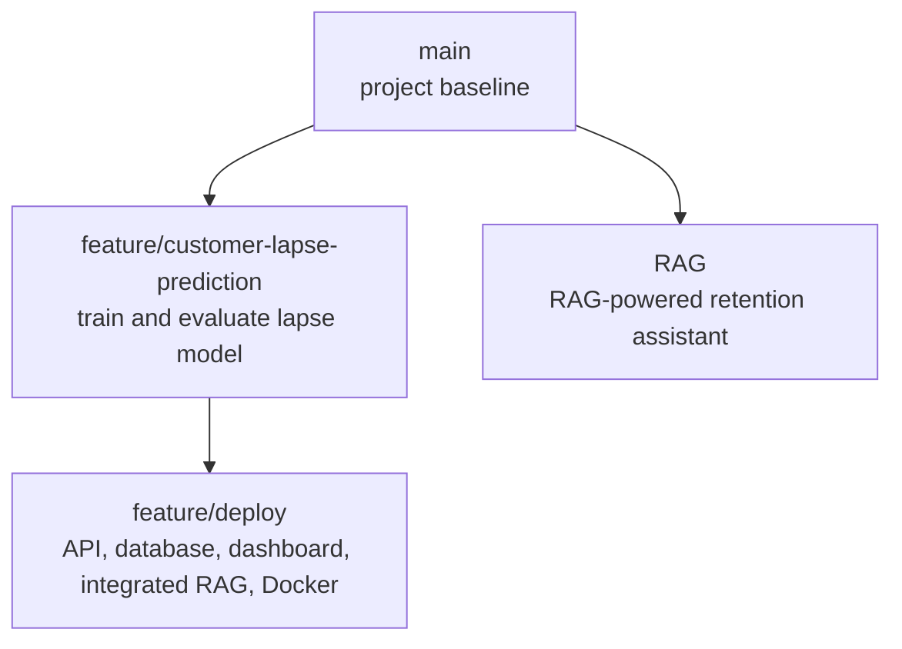
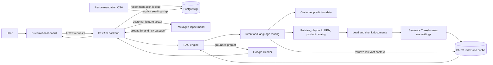

# Retail AI Intelligence Portal

A retail customer-retention application that brings together customer lapse-risk prediction, product recommendations, and a document-grounded assistant. It has a Streamlit dashboard, a FastAPI backend, and PostgreSQL for recommendation lookups; Docker Compose runs the services together.

## Repository branches and development flow

The current Git history shows the work split into a baseline, two parallel feature branches, and an integration/deployment branch:



- **`main`** — project baseline and shared data foundation.
- **`feature/customer-lapse-prediction`** — developed and evaluated the customer lapse model and prepared prediction outputs and model artifacts.
- **`RAG`** — developed a retrieval-augmented retention assistant as a parallel feature branch from the baseline.
- **`feature/deploy`** — continues from `feature/customer-lapse-prediction`; adds the application layers, Streamlit portal, database and Docker setup, and includes its own RAG implementation. In the observed history, `RAG` is a sibling branch rather than an ancestor of `feature/deploy`; do not assume that branch was merged into it.

The end-to-end delivery path is: prepare model and reference data → package the prediction model and recommendation data → expose application services through FastAPI → connect the Streamlit dashboard → run the backend, frontend, and PostgreSQL together with Docker Compose.

## System architecture at a glance



Docker Compose connects these services on an internal network. The browser opens Streamlit at `http://localhost:8501`; Streamlit calls the backend at `http://backend:8000` from inside the Compose network. PostgreSQL persists recommendation records in a named volume.

## What is implemented

- **Product recommendations:** Look up a precomputed top-10 product ranking for a customer. The dashboard displays products and estimated basket values and supports CSV download. Recommendations are read from PostgreSQL, initially loaded from the packaged recommendation CSV; the deployed service does not train or score products at request time.
- **Customer lapse-risk prediction:** Submit customer activity and value features to a packaged scikit-learn model. The dashboard shows an estimated lapse probability, a risk category, and the current session's recent predictions. Preset profiles and basic consistency warnings are provided.
- **Retail RAG assistant:** Ask questions about customer segments, products, retention guidance, promotion policy, and business rules. The assistant routes questions to relevant customer data and/or reference documents, retrieves passages from a FAISS index, and uses Gemini to compose a response.
- **English and Arabic question handling:** The RAG query router includes language detection and Arabic text normalization and routing.
- **API and service layers:** FastAPI exposes versioned endpoints and a health check. Pydantic schemas validate requests and responses, and the application uses SQLAlchemy to connect to PostgreSQL.
- **Containerized setup:** Separate backend and frontend images are orchestrated with PostgreSQL. Compose health checks gate service startup, and the backend image includes the model and recommendation artifacts.

The dashboard provides decision support; it does not automatically send offers or contact customers. Retention actions require human review. Risk probabilities are model estimates, not verified calibration.

## Implemented pipelines

### 1. Product recommender

#### What is included

The deployed recommender is a **precomputed customer-to-product ranking**, not a model that trains or generates new recommendations when the application runs. Its source artifact is `artifacts/recommender/product_recommendations_top10.csv`. The file contains 50,160 rows: ten ranked products for each of 5,016 customers, with an `as_of_date` of `2011-06-30`.

| Artifact field | Meaning in the delivered output |
|---|---|
| `customer_id` | Customer the recommendation is for |
| `rank` | Position in that customer's recommendation list |
| `stock_code`, `product_name` | Recommended catalog product |
| `recommendation_score` | Stored ranking score; the artifact does not document its formula |
| `median_unit_price` | Historical median unit price associated with the product recommendation |
| `median_quantity` | Historical median quantity associated with the product recommendation |
| `estimated_basket_value_gbp` | Historical estimate, calculated as median unit price × median quantity |
| `as_of_date` | Snapshot date attached to the generated recommendations |

The score is a **ranking signal**, not a calibrated probability that the customer will buy the product. The estimated basket value is a historical proxy, not expected revenue. The artifact includes the final values, but this branch does not contain the recommender's training/scoring implementation or documentation of the algorithm, input interaction data, candidate generation, or score formula. Those details should not be inferred from the CSV column names alone.

#### Serving pipeline

1. The explicit `docker compose exec backend python -m app.db.seed` setup command reads the artifact into PostgreSQL's `recommendations` table. This is not an automatic startup step.
2. The dashboard calls `GET /api/v1/recommendations/{customer_id}`.
3. FastAPI queries that customer's stored rows, sorts by ascending `rank`, and limits the result to ten.
4. The response schema returns `rank`, `stock_code`, `product_name`, and `estimated_basket_value_gbp`. Although the database table and source CSV also contain the score, median price, median quantity, and snapshot date, those columns are not currently exposed by this endpoint.
5. The dashboard displays the results and can download the returned records as CSV.

This design serves the saved ranking; it does not train, refresh, personalize from live activity, or rerank products at request time. A customer absent from the seeded artifact receives a not-found response. To document or reproduce how the recommendations themselves are generated, add the upstream training/scoring pipeline and its evaluation separately.

### 2. Customer lapse-risk prediction

The dashboard submits the customer's 18 model features to `POST /api/v1/predict-lapse`. Pydantic validates the request. The lapse service arranges fields in the model's expected order and calls the packaged scikit-learn model's `predict_proba`. The API returns the customer ID, estimated lapse probability, and risk category. The interface supports preset profiles, basic checks for cumulative order/spend values, and a short prediction history held for the current Streamlit session.

The current backend category calculation uses the configured risk threshold (default `0.30`): High at or above that threshold, Medium at or above 60% of it, and Low below it. The dashboard's risk legend instead shows Low below `0.30`, Medium from `0.30` to `0.50`, and High from `0.50`. These are currently inconsistent and should not be interpreted as the same categorization.

### 3. RAG assistant

The dashboard sends a question to `POST /api/v1/rag-chat`. The RAG engine routes it to structured customer data, policy/playbook/KPI documents, product catalog documents, or a combination. It retrieves relevant context, builds a prompt, and calls Gemini. The current API response includes the question and generated answer.

For knowledge retrieval, Markdown sources and JSONL catalog entries are loaded, validated, and chunked. Sentence Transformers creates local embeddings; FAISS searches the vector index. A fingerprint over source content and embedding/chunk settings lets the engine reuse a fresh cached index in `.cache/index`. If the embedding model cannot load, a lower-quality keyword-hash fallback is available. The router includes English and Arabic language detection, normalization, and intent patterns.

Customer-risk questions can also query the validated customer prediction CSV deterministically, rather than relying on the language model to calculate values. The RAG path still needs Gemini credentials for generated natural-language answers.

## Components and responsibilities

```text
app/                         FastAPI application, endpoints, schemas, DB, services
  api/v1/endpoints/          Recommendations, lapse prediction, RAG chat
  db/                        SQLAlchemy session/model and recommendation seeder
  services/                  Model prediction, recommendation lookup, RAG wrapper
src/                         RAG document, routing, retrieval, prompt, and LLM logic
artifacts/
  lapse_model/               Packaged lapse model and metadata
  recommender/               Top-10 recommendation source CSV
data/                        Customer prediction data and RAG source documents
app_streamlit.py             Streamlit dashboard
Dockerfile.backend           FastAPI image
Dockerfile.frontend          Streamlit image
docker-compose.yml           Backend, frontend, and PostgreSQL services
```

### Dashboard

`app_streamlit.py` implements the three user-facing tabs: recommendations, lapse prediction, and the RAG assistant. It calls the backend using `API_BASE_URL`, checks `/health`, and provides customer-risk presets, form checks, response rendering, chat history, and recommendation CSV export.

### Backend API

`app/main.py` creates the FastAPI application and registers versioned route groups. Endpoint functions live under `app/api/v1/endpoints/`; Pydantic request/response definitions are in `app/schemas/`. The routes are intentionally thin and call services for recommendation queries, model inference, or RAG.

### Data and persistence

`app/db/session.py` configures the SQLAlchemy engine using `DATABASE_URL`; `app/db/models.py` describes the recommendation table; and `app/db/seed.py` loads recommendation records from the packaged CSV. PostgreSQL runs as a separate Compose service and persists data in `postgres_data`.

The `artifacts/` directory contains the serialized lapse model, model metadata, and recommendation source data. The `data/` directory contains customer prediction snapshots used by RAG and the written/catalog knowledge sources:

- `retention_playbook.md` — retention guidance.
- `promotion_policy.md` — promotion and offer policy.
- `business_rules_kpis.md` — business definitions, KPIs, and risk guidance.
- `product_catalog_documents.jsonl` — product text and metadata.
- `customer_lapse_predictions.csv` — structured customer risk snapshots for assistant queries.

### RAG internals

The `src/` package separates the assistant's responsibilities:

- `config.py` — environment settings, model/index options, source-file names, and risk thresholds.
- `document_loader.py` and `chunking.py` — load/validate reference documents and divide content into searchable chunks.
- `embeddings.py` and `vector_store.py` — create local embeddings and build, fingerprint, persist, and search the FAISS index.
- `retriever.py` — retrieve knowledge passages and product catalog entries with relevance scoring.
- `query_router.py` — detect language and intent, extract IDs, and select structured-data or document retrieval paths.
- `customer_data.py` — validate and query customer prediction snapshots deterministically.
- `prompt_builder.py` and `llm_client.py` — assemble grounded prompts and call Gemini with user-safe error handling.
- `rag_engine.py` — coordinate routing, customer queries, retrieval, prompt creation, and answer generation.

### Container and runtime configuration

`Dockerfile.backend` installs backend dependencies and packages the application source, data, and model artifacts. `Dockerfile.frontend` installs Streamlit dependencies and packages the dashboard. `docker-compose.yml` runs the backend, frontend, and PostgreSQL, configures service URLs and database credentials, and uses health checks to sequence startup. The frontend calls `http://backend:8000/api/v1` on the internal Docker network; `localhost` is for accessing published ports from the host machine.

## Run with Docker Compose

Prerequisites: Docker Desktop with Compose, and a Gemini API key to generate RAG answers.

1. From the repository root, create a `.env` file containing your key:

   ```dotenv
   GEMINI_API_KEY=your_gemini_api_key
   GEMINI_MODEL=gemini-2.5-flash
   ```

   Do not commit the `.env` file or share the key. Gemini settings can also be supplied as environment variables.

2. Build and start the services:

   ```powershell
   docker compose up -d --build
   ```

3. Seed recommendations into PostgreSQL:

   ```powershell
   docker compose exec backend python -m app.db.seed
   ```

   This loads `artifacts/recommender/product_recommendations_top10.csv` into the database. It is an explicit step; Compose does not seed the recommendation table automatically. Re-running the seeder replaces that table's contents.

4. Open the dashboard at <http://localhost:8501>. The API is available at <http://localhost:8000>, with interactive documentation at <http://localhost:8000/docs> and health status at <http://localhost:8000/health>.

To stop the services while retaining the PostgreSQL volume:

```powershell
docker compose down
```

To also delete the PostgreSQL data volume, use `docker compose down -v`; this deletes persisted database data.

## API endpoints

| Method | Path | Purpose |
|---|---|---|
| `GET` | `/health` | Backend health check |
| `GET` | `/api/v1/recommendations/{customer_id}` | Retrieve a customer's top recommendations |
| `POST` | `/api/v1/predict-lapse` | Predict lapse probability and risk category |
| `POST` | `/api/v1/rag-chat` | Ask the retail knowledge assistant a question |

Example lapse request:

```json
{
  "customer_id": 12346,
  "recency_days": 120,
  "frequency_orders": 5,
  "monetary": 450.0,
  "average_order_value": 90.0,
  "average_basket_quantity": 12.5,
  "distinct_products": 15,
  "tenure_days": 365,
  "average_days_between_orders": 30.0,
  "orders_last_30d": 0,
  "orders_last_90d": 0,
  "orders_last_180d": 2,
  "spend_last_30d": 0.0,
  "spend_last_90d": 0.0,
  "spend_last_180d": 150.0,
  "cancellation_count": 0,
  "cancellation_value": 0.0,
  "cancellation_rate": 0.0,
  "country": "United Kingdom"
}
```

Example RAG request:

```json
{
  "question": "What retention actions do you recommend for high-risk customers?"
}
```
