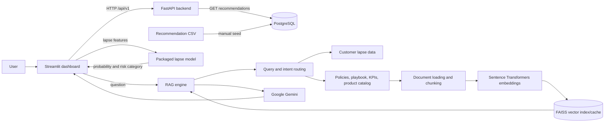

# Retail AI Intelligence Portal

A retail customer-retention application that brings together customer lapse-risk prediction, product recommendations, and a document-grounded assistant. It has a Streamlit dashboard, a FastAPI backend, and PostgreSQL for recommendation lookups; Docker Compose runs the services together.

## What is implemented

- **Product recommendations:** Look up the top product recommendations for a customer. The dashboard displays products and estimated basket values and supports CSV download. Recommendations are read from PostgreSQL, initially loaded from the packaged recommendation CSV.
- **Customer lapse-risk prediction:** Submit customer activity and value features to a packaged scikit-learn model. The dashboard shows an estimated lapse probability, a risk category, and the current session's recent predictions. Preset profiles and basic consistency warnings are provided.
- **Retail RAG assistant:** Ask questions about customer segments, products, retention guidance, promotion policy, and business rules. The assistant routes questions to relevant customer data and/or reference documents, retrieves passages from a FAISS index, and uses Gemini to compose a response.
- **English and Arabic question handling:** The RAG query router includes language detection and Arabic text normalization and routing.
- **API and service layers:** FastAPI exposes versioned endpoints and a health check. Pydantic schemas validate requests and responses, and the application uses SQLAlchemy to connect to PostgreSQL.
- **Containerized setup:** Separate backend and frontend images are orchestrated with PostgreSQL. Compose health checks gate service startup, and the backend image includes the model and recommendation artifacts.

The dashboard provides decision support; it does not automatically send offers or contact customers. Retention actions require human review. Risk probabilities are model estimates, not verified calibration.

## Application pipeline



### Request flows

1. **Recommendations:** The dashboard calls `GET /api/v1/recommendations/{customer_id}`. FastAPI queries the PostgreSQL `recommendations` table, orders results by rank, and returns up to ten entries. Seed the table from the supplied CSV before using this feature.
2. **Lapse prediction:** The dashboard sends customer features to `POST /api/v1/predict-lapse`. The service arranges the input in the model's expected feature order, calls `predict_proba`, and returns a probability and category. The backend currently labels risk as High at or above its configured threshold (default `0.30`), Medium at or above 60% of that threshold, and Low below it. The dashboard's legend and bar instead show Low below `0.30`, Medium from `0.30` to `0.50`, and High from `0.50`; these displayed bands are not currently synchronized with the backend categories.
3. **RAG question answering:** The dashboard sends a question to `POST /api/v1/rag-chat`. The engine determines whether it needs customer data, policy/playbook/KPI passages, product-catalog content, or a combination. It retrieves and assembles context, then requests a response from Gemini. The endpoint currently returns the question and answer.
4. **RAG index preparation:** On the first RAG request, source documents are loaded and chunked, embeddings are computed, and a FAISS index is built and cached under `.cache/index`. A content/configuration fingerprint allows a fresh cache to be reused. If the configured sentence-transformers model cannot load, the engine can use its lower-quality keyword-hash fallback.

## Architecture and important files

```text
app/                         FastAPI application, endpoints, schemas, DB, services
  api/v1/endpoints/          Recommendations, lapse prediction, RAG chat
  db/                        SQLAlchemy session/model and recommendation seeder
  services/                  Model prediction, recommendation lookup, RAG wrapper
src/                         RAG document, routing, retrieval, prompt, and LLM logic
artifacts/
  lapse_model/               Packaged lapse model and metadata
  recommender/               Top-10 recommendation source CSV
data/                        Customer prediction data and RAG source documents
app_streamlit.py             Streamlit dashboard
Dockerfile.backend           FastAPI image
Dockerfile.frontend          Streamlit image
docker-compose.yml           Backend, frontend, and PostgreSQL services
```

RAG reference files in `data/` include the retention playbook, promotion policy, business rules/KPIs, product catalog documents, and customer lapse prediction data.

## Run with Docker Compose

Prerequisites: Docker Desktop with Compose, and a Gemini API key to generate RAG answers.

1. From the repository root, create a `.env` file containing your key:

   ```dotenv
   GEMINI_API_KEY=your_gemini_api_key
   GEMINI_MODEL=gemini-2.5-flash
   ```

   Do not commit the `.env` file or share the key. Gemini settings can also be supplied as environment variables.

2. Build and start the services:

   ```powershell
   docker compose up -d --build
   ```

3. Seed recommendations into PostgreSQL:

   ```powershell
   docker compose exec backend python -m app.db.seed
   ```

   This loads `artifacts/recommender/product_recommendations_top10.csv` into the database. It is an explicit step; Compose does not seed the recommendation table automatically. Re-running the seeder replaces that table's contents.

4. Open the dashboard at <http://localhost:8501>. The API is available at <http://localhost:8000>, with interactive documentation at <http://localhost:8000/docs> and health status at <http://localhost:8000/health>.

To stop the services while retaining the PostgreSQL volume:

```powershell
docker compose down
```

To also delete the PostgreSQL data volume, use `docker compose down -v`; this deletes persisted database data.

## API endpoints

| Method | Path | Purpose |
|---|---|---|
| `GET` | `/health` | Backend health check |
| `GET` | `/api/v1/recommendations/{customer_id}` | Retrieve a customer's top recommendations |
| `POST` | `/api/v1/predict-lapse` | Predict lapse probability and risk category |
| `POST` | `/api/v1/rag-chat` | Ask the retail knowledge assistant a question |

Example lapse request:

```json
{
  "customer_id": 12346,
  "recency_days": 120,
  "frequency_orders": 5,
  "monetary": 450.0,
  "average_order_value": 90.0,
  "average_basket_quantity": 12.5,
  "distinct_products": 15,
  "tenure_days": 365,
  "average_days_between_orders": 30.0,
  "orders_last_30d": 0,
  "orders_last_90d": 0,
  "orders_last_180d": 2,
  "spend_last_30d": 0.0,
  "spend_last_90d": 0.0,
  "spend_last_180d": 150.0,
  "cancellation_count": 0,
  "cancellation_value": 0.0,
  "cancellation_rate": 0.0,
  "country": "United Kingdom"
}
```

Example RAG request:

```json
{
  "question": "What retention actions do you recommend for high-risk customers?"
}
```
